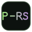

<p align="center">
  
</p>

<h1 align="center">prog-rs</h1>

<p align="center">
  A minimal GPU-accelerated desktop app built with <a href="https://gpui.rs">GPUI</a>.
</p>

## Run

```sh
cargo install --path .
prog-rs
```

Launches a small window with an animated gradient — currently a placeholder
while the app's real identity is figured out.
